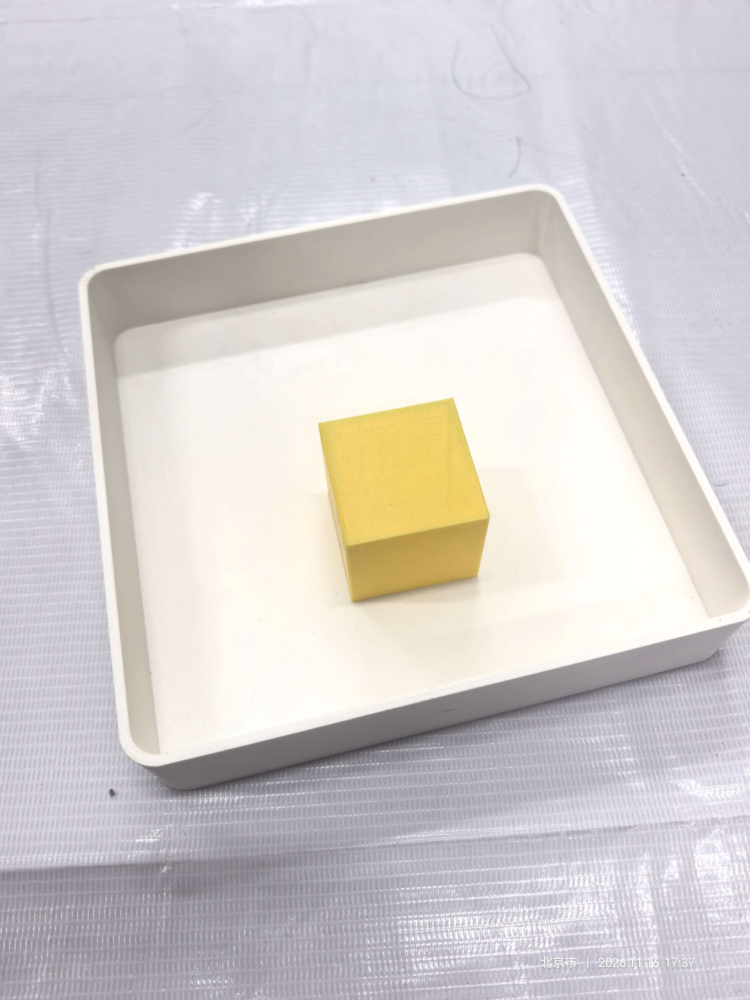

# 智能分拣：团队照片采集

收集九类物料的自摄原图，之后统一检查、标注和训练。全队首轮合计约500张，不是每人500张。

## 拍摄示例

这是团队提供的实拍参考：将物料放在托盘内，保证整个物料完整入镜、轮廓清楚，摆好后手退出画面。可以参考这种背景和摆放方式，不要求大家都使用黄色物料或固定在同一位置。

这张图保留原样作为说明示例，不自动加入训练集。正式拍摄请关闭右下角的地点、日期水印；相机尽量固定在实际使用的位置和高度，使托盘工作区占画面主要部分，减少无关背景。示例的斜视角不等于最终相机标定视角，必须另采最终实物相机的数据。

同一类也要变换位置、旋转方向、稳定朝向和不同个体，并补充多类别混合场景。不要只拍正中央的单个物料，也不要凭颜色判断类别。详见[拍摄示例说明](拍摄示例说明.md)。

## 同学怎么上传（无需 Git 命令）

1. 用自己的 GitHub 账号打开主仓库，点击 **Fork（创建副本）→ Create fork（确认创建副本）**，无需负责人邀请。
2. 优先按 [视频拍摄说明](VIDEO_GUIDE.md) 录制，每类一个视频。先交一小段试拍，经负责人检查后再批量拍摄。直接拍照片也可以先拍10张。
3. 在电脑建立批次文件夹，如 `20261116_team01_01`（日期_同学代号_批次）。将原图放入其中的 `images` 文件夹，复制本仓库 `templates/metadata.md` 到批次文件夹并填写。
4. 打开自己的仓库副本中的 `incoming`（待检查照片）目录，选择 **Add file（添加文件）→ Upload files（上传文件）**，拖入整个批次文件夹。检查预览路径是 `incoming/批次名/images/照片.jpg`。
5. 填写提交说明，如“team01 第一批30张”，点击 **Commit changes（提交更改）**。上传后打开目录核对图片和批次记录 metadata.md。
6. 回到副本首页，点击 **Contribute（贡献）→ Open pull request（发起合并请求）**，确认目标是主仓库，再提交。负责人检查并合并后，主仓库才会出现照片。

公开仓库允许所有人查看和 Fork，不允许所有人直接写入主仓库。以上流程无需逐个邀请，但合并仍由负责人完成。公开提交的照片和文字任何人都能下载。

每人只新增自己的批次，避免重名、覆盖或删除他人文件。网页一般每次最多100个文件，单文件不超过25MiB；推荐每次20–50张，超限分次上传。保持原图分辨率，不传ZIP、视频、模型权重和账户凭据。

## 怎么分工拍摄

| 场景 | 全队建议数量 | 要求 |
|---|---:|---|
| 单物料 | 180 | 九类各20张，轮换每类10个实物，改变位置、旋转与稳定朝向 |
| 多物料分开 | 150 | 每张3–8个，混合不同类别和颜色，覆盖画面不同区域 |
| 接触和遮挡 | 100 | 贴合、部分遮挡及实物实际可能出现的堆叠 |
| 空台和困难场景 | 50–70 | 空台、边缘、阴影、实际光照变化 |

大家按类别认领单物料任务，按批次认领混合任务；可一人操作最终相机，其他人摆放记录。不要求每人拍完整九类。

- 优先使用最终实物相机、安装高度和分拣台背景。手机照片标明来源，仅作为补充。
- 每拍一张重新摆放，不用连续相似帧充数。
- 保存未画框、无滤镜的清晰原图，不截图、不经过聊天软件压缩。
- 手退出画面再拍；不拍人脸、证件、屏幕或个人信息。
- 新日期、设备或重新布置的场景建立新批次。同场景连续拍摄须记录关联。
- 形状从当前视角无法区分时记录问题，不猜标签。

上传时不用画框，后续统一标注。固定类别见 `classes.json`，混合图片会标注所有可辨识目标。旧七类借用数据不能直接套用这些九类编号。

## 管理员

按团队要求使用公开仓库和 Fork + Pull request 投稿。负责人检查后统一合并，不自动合并陌生提交，不共享账号密码。视频原文件通过团队约定的网盘或本地文件交接，不直接提交到 Git；筛选后的照片再进入仓库。

原图不改写；训练用独立快照并记录commit ID，按场景/拍摄批次划分训练、验证、测试，避免近似帧泄漏。独立真实测试集不回流训练。

首轮使用普通Git支持网页上传；数据增长到多GB前评估Git LFS或对象存储及配额。删除照片不会从Git历史中自动释放空间。本仓库未启用LFS。
