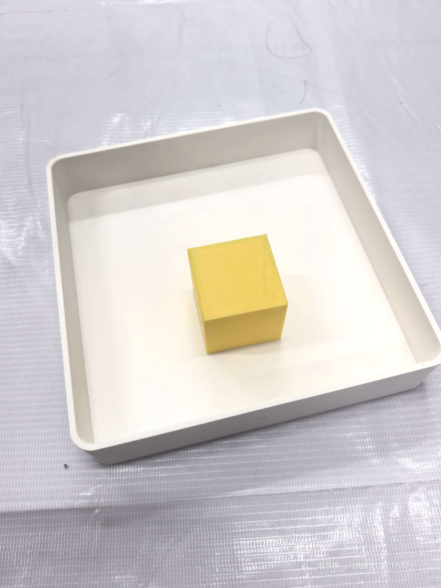

# 照着示例怎么拍

## 可以参考的地方

- 物料放在浅色托盘内，背景相对简单。
- 物料完整入镜，边缘和表面可以辨认，没有手遮住物料。
- 适合作为单物料场景的摆放示例。九类都要采集，不能只拍示例这一种。

## 正式采集时调整

- 关闭相机的地点、日期和文字水印。示例原图保留不改，仅供说明，不自动作为训练样本。
- 相机固定，优先采用最终实物的相机、安装位置和高度；手机拍摄需在批次记录中注明。
- 让托盘工作区域占主要画面，减少上方无关空白，但不要裁掉物料。不要把示例的倾斜角度当作唯一标准。
- 避免高光使浅色物料和托盘边缘分不清；锁定清晰焦点，保持合理曝光。
- 每次调整物料的位置、朝向和组合，覆盖中心、边缘及不同个体。颜色不是形状类别。

## 省事的拍法：每类一段视频

1. 每类约1–2分钟，轮换该类的不同物料。
2. 摆好后手退出画面，静止2–3秒，再换一种摆放；每段约15–20种不同摆放。
3. 全队额外补充2–3段混合场景：每次3–8个物料，包含分散、贴合和部分遮挡，也录一点空托盘。
4. 保存原视频，不加滤镜、不通过聊天软件压缩；填写批次记录。

视频通过团队约定的网盘或本地文件交接给负责人，之后抽帧、去重、检查清晰度和手部遮挡。当前仓库没有自动抽帧服务。筛选后的图片再上传到仓库，后续统一画框标注；同一视频不拆到训练和测试两边。

网页投稿教程见[首页说明](README.md)，详细视频要求见[视频拍摄指南](VIDEO_GUIDE.md)，记录表见[批次模板](templates/metadata.md)。
